# Virgosoft Exchange

Virgosoft Exchange is a Laravel 13 cryptocurrency limit-order trading
assessment. The backend implements wallet balances, buy and sell reservations,
cancellation, an open orderbook, full-match settlement, order history,
commission calculation, PostgreSQL concurrency protection, and optional
persisted trade records. The Inertia/Vue screens provide the live trading demo
with limit-order placement, wallet/order history, orderbook polling, and
private-channel updates when Pusher is configured.

**Live demo:** <https://virgosoft.thavarshan.com/>.
The login page lists the two pre-funded demo accounts and fills the form for
you.

## Screenshots

Images follow your GitHub theme (dark or light). They are generated from the
real application, with trades produced by the matching engine, so they show
what a reviewer will see after signing in with the demo accounts.

### Sign in

The login page tells reviewers about the demo accounts and fills the form for
them.

<p align="center">
  <picture><source media="(prefers-color-scheme: dark)" srcset=".github/screenshots/desktop-dark/01-login.png">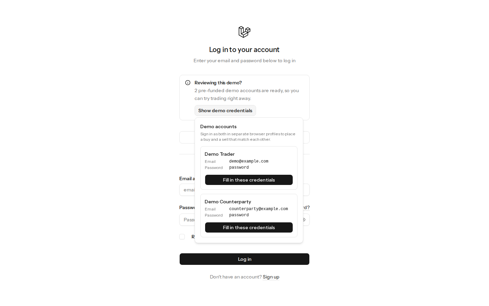</picture>
</p>

### Dashboard

Balances, a daily executed-value chart, orders by status, and recent
executions, with the live-connection indicator.

<p align="center">
  <picture><source media="(prefers-color-scheme: dark)" srcset=".github/screenshots/desktop-dark/04-dashboard.png">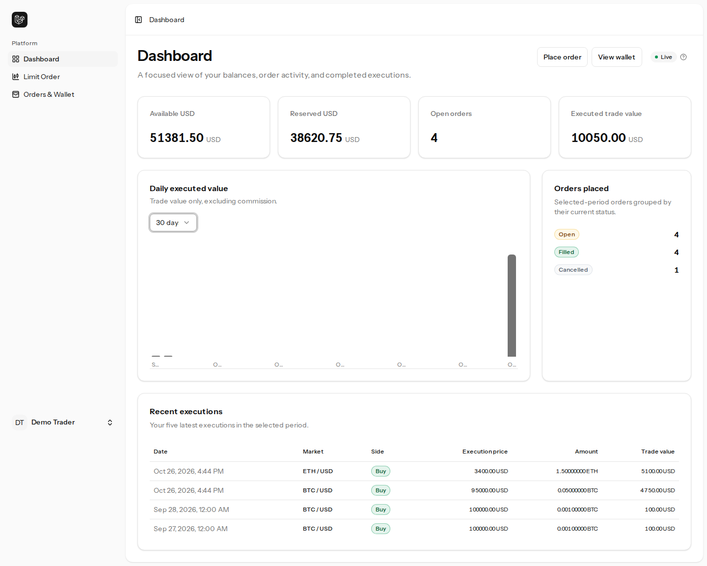</picture>
</p>

### Limit order

Exact USD and asset precision, with the reserved amount and commission
previewed before submitting.

<p align="center">
  <picture><source media="(prefers-color-scheme: dark)" srcset=".github/screenshots/desktop-dark/05-limit-order.png">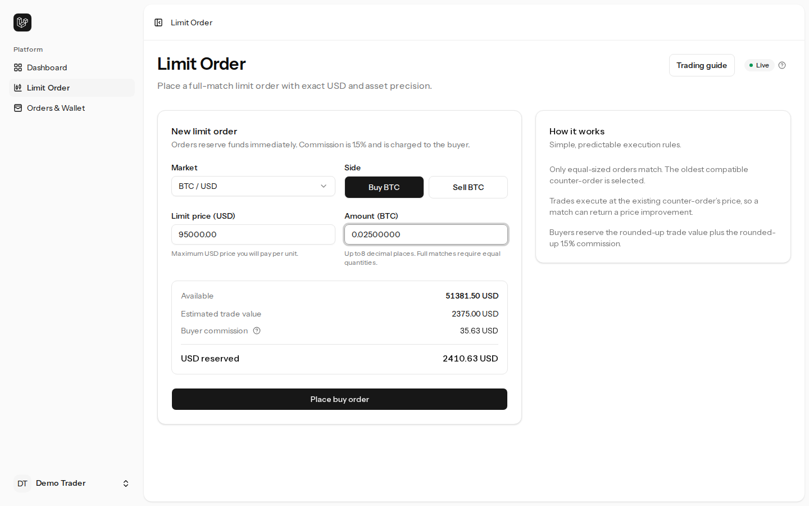</picture>
</p>

### Orders and wallet

Wallet balances, filterable order history, and the shared orderbook.

<p align="center">
  <picture><source media="(prefers-color-scheme: dark)" srcset=".github/screenshots/desktop-dark/06-orders-and-wallet.png">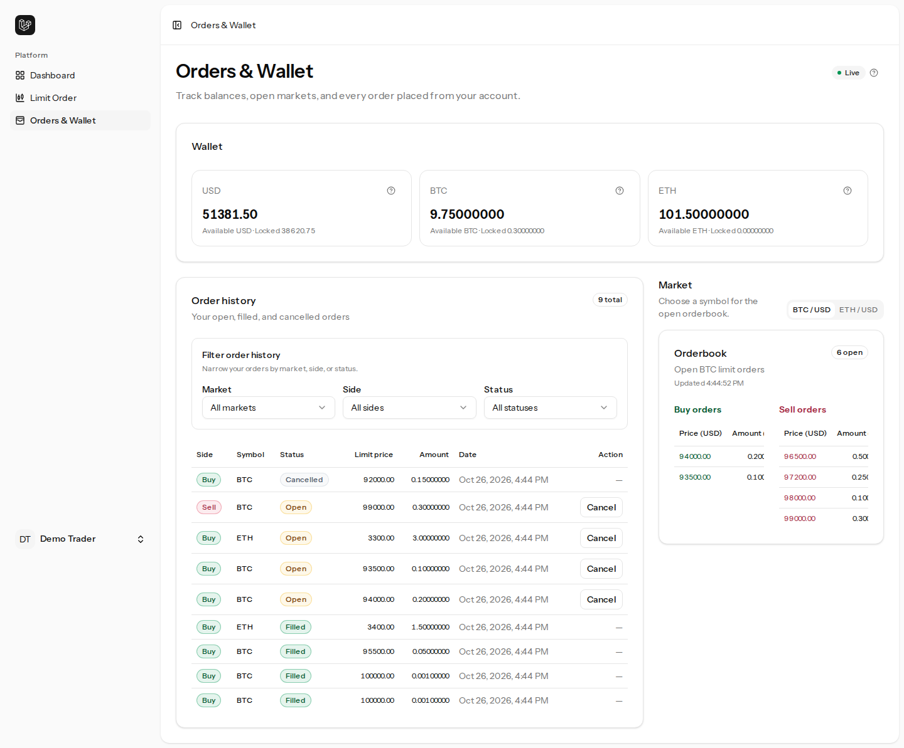</picture>
</p>

### Account and settings

<table>
  <tr>
    <td align="center" valign="top"><picture><source media="(prefers-color-scheme: dark)" srcset=".github/screenshots/desktop-dark/07-settings-profile.png">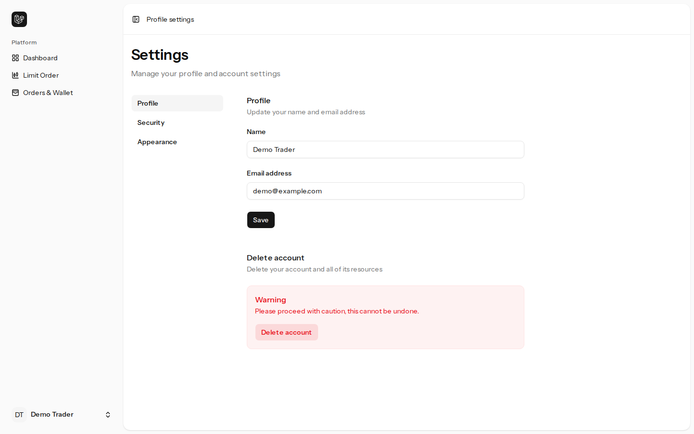</picture><br><sub>Profile</sub></td>
    <td align="center" valign="top"><picture><source media="(prefers-color-scheme: dark)" srcset=".github/screenshots/desktop-dark/08-settings-security.png">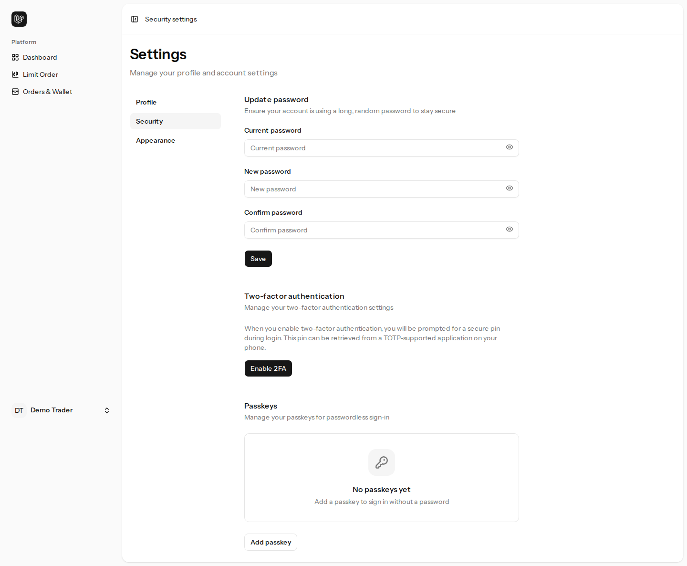</picture><br><sub>Security, two-factor, passkeys</sub></td>
    <td align="center" valign="top"><picture><source media="(prefers-color-scheme: dark)" srcset=".github/screenshots/desktop-dark/09-settings-appearance.png">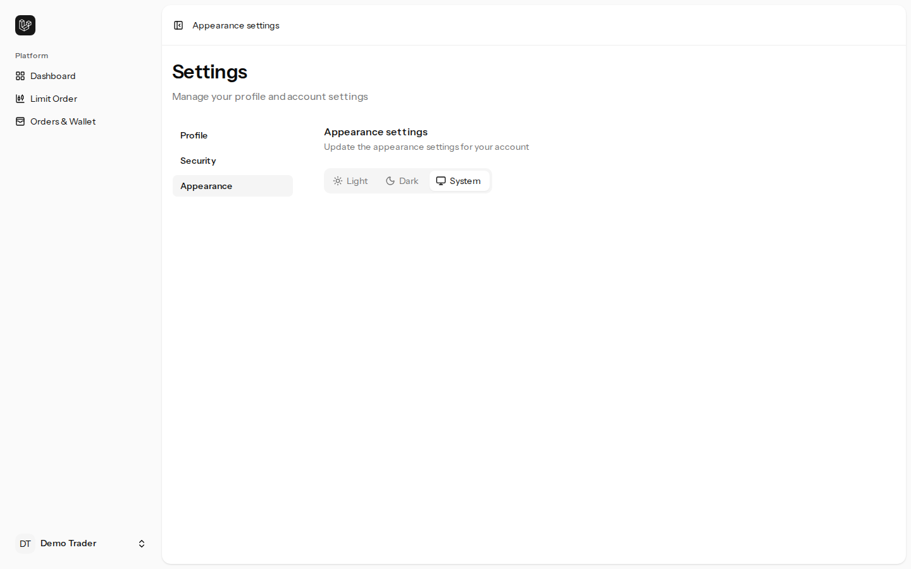</picture><br><sub>Appearance</sub></td>
  </tr>
</table>

<table>
  <tr>
    <td align="center" valign="top"><picture><source media="(prefers-color-scheme: dark)" srcset=".github/screenshots/desktop-dark/02-register.png">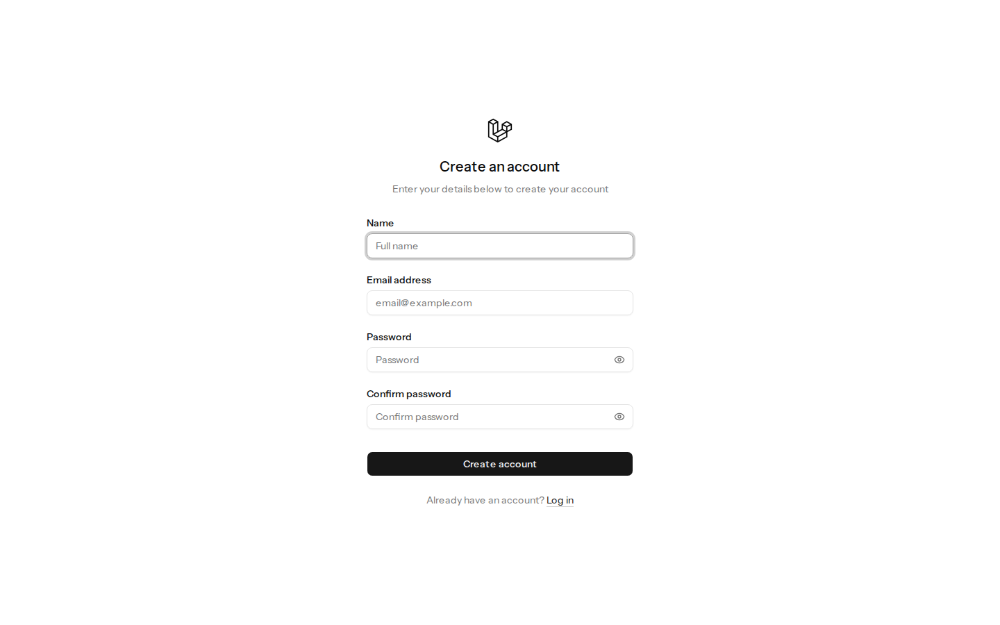</picture><br><sub>Register</sub></td>
    <td align="center" valign="top"><picture><source media="(prefers-color-scheme: dark)" srcset=".github/screenshots/desktop-dark/03-forgot-password.png">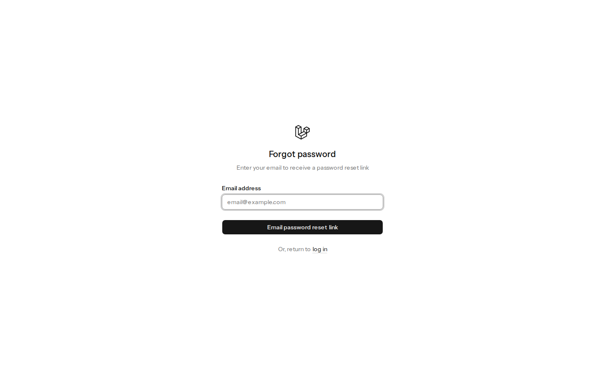</picture><br><sub>Forgot password</sub></td>
  </tr>
</table>

### On a phone

<table>
  <tr>
    <td align="center" valign="top"><picture><source media="(prefers-color-scheme: dark)" srcset=".github/screenshots/mobile-dark/01-login.png">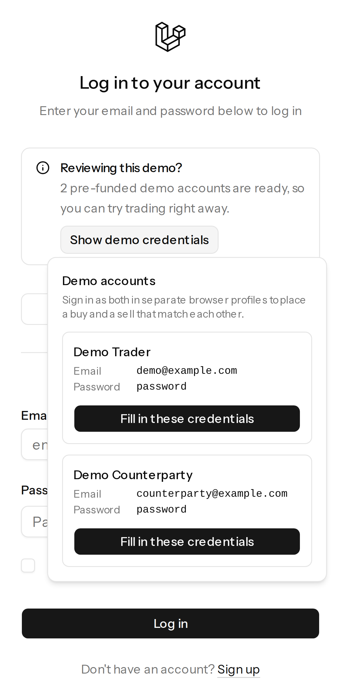</picture><br><sub>Login</sub></td>
    <td align="center" valign="top"><picture><source media="(prefers-color-scheme: dark)" srcset=".github/screenshots/mobile-dark/04-dashboard.png">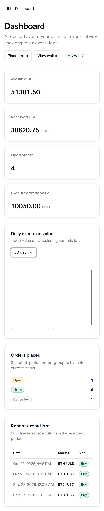</picture><br><sub>Dashboard</sub></td>
    <td align="center" valign="top"><picture><source media="(prefers-color-scheme: dark)" srcset=".github/screenshots/mobile-dark/05-limit-order.png">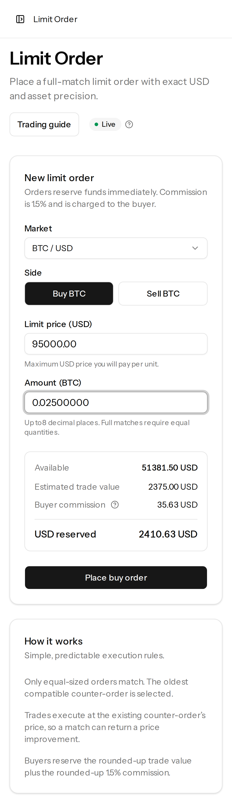</picture><br><sub>Limit order</sub></td>
    <td align="center" valign="top"><picture><source media="(prefers-color-scheme: dark)" srcset=".github/screenshots/mobile-dark/06-orders-and-wallet.png">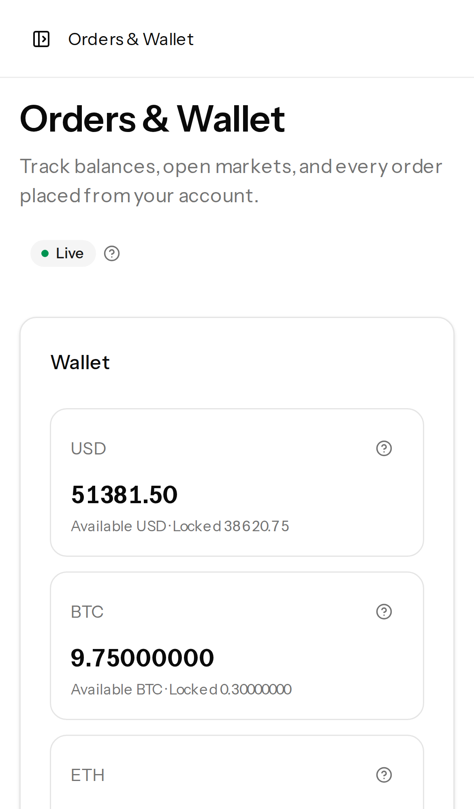</picture><br><sub>Orders and wallet</sub></td>
  </tr>
</table>

To regenerate them after a UI change, run `npm run screenshots` from the same
environment as the browser tests (see [Browser tests](#browser-tests)); it
rewrites `.github/screenshots/`.

## Stack

- Laravel 13.38, PHP 8.5 Sail runtime (Composer requires PHP ^8.3), Fortify,
  Sanctum, PHPUnit, Pint, and Larastan
- PostgreSQL 17 with database-backed sessions, cache, and queues
- Inertia 3, Vue 3, TypeScript, Vite, Tailwind CSS 4, and Wayfinder
- Axios for API requests, Laravel Echo and Pusher JS for private channels
- Laravel Sail and Docker Compose for the application and PostgreSQL services

## Prerequisites

Install Docker Desktop and Git. PHP, Composer, Node, npm, PostgreSQL, and the
application runtime are provided by Laravel Sail.

## Sail setup

From a fresh checkout:

```shell
make setup
./vendor/bin/sail artisan migrate --seed
make dev
```

`make setup` creates `.env` when needed, installs Composer dependencies,
builds and starts Sail, generates an application key when one is not already
configured, and installs frontend dependencies. Docker keeps frontend
dependencies in a Linux-specific `sail-node-modules` volume, so host macOS or
Windows native bindings cannot interfere with Sail’s frontend commands.

The pull-request CI also runs this exact `make setup` path from a clean Docker
checkout before running the backend tests, frontend tests, and production
build. This keeps the documented setup path separate from the faster host-tool
CI checks.

Keep `make dev` running in a terminal; it starts Laravel, Vite, and the queue
listener before you open the application. A separate queue worker is not
needed while this command is running.

The application is available at <http://localhost:8080>. The Vite development
server uses port `5173`. PostgreSQL runs in the `pgsql` service and is exposed
to host tools on `127.0.0.1:5432` by default.

Useful commands:

```shell
make dev                         # Laravel, Vite, and queue listener
./vendor/bin/sail artisan queue:work # Only when running without make dev
make migrate
make fresh                       # destructive disposable-data reset
```

Inside the application container, use `DB_HOST=pgsql`. From TablePlus or
another host application, use `127.0.0.1`, port `5432`, and the credentials in
`.env`.

## Demo accounts

Local and testing seeds create two accounts. Both use the password
`password`, start with `$1000.00`, `1.00000000 BTC`, and `10.00000000 ETH`:

- `demo@example.com`
- `counterparty@example.com`

Run `./vendor/bin/sail artisan app:seed-default-user` to create only the
default demo account. Seeders are restricted to local and testing
environments. They initialize missing users and asset rows but do not overwrite
existing balances, reservations, or orders when rerun.

When `DEMO_ACCOUNTS=true` (set in `.env.example` for local development), the
login page shows a **Reviewing this demo?** notice. Its popover lists both
accounts with their passwords and fills the form with one click. On a deployed
demo environment the same flag makes `php artisan app:ensure-demo-accounts`
create the two accounts with a larger bankroll of `$100000.00`,
`10.00000000 BTC`, and `100.00000000 ETH`, so a reviewer can trade
realistic sizes. The command never changes the balances of existing accounts.
The passwords are public by design, so leave `DEMO_ACCOUNTS` unset anywhere
that holds real data. Newly registered users still start with no funds.

## Backend API

All API responses are JSON. Sanctum session authentication protects private
endpoints; guests receive `401` responses.

- `GET /api/session` — current authenticated user.
- `GET /api/profile` — current USD and asset balances.
- `GET /api/profile/orders` — the user’s complete order history,
  20 per page. Optional `symbol=BTC|ETH`, `side=buy|sell`, and
  `status=1|2|3` filters combine with AND; `page` selects a page and all
  active filters are preserved in pagination links.
- `GET /api/orders?symbol=BTC` — shared open orderbook.
- `POST /api/orders` — place a buy or sell order and reserve funds.
- `POST /api/orders/{order}/cancel` — cancel an owned open order and release
  its reservation.

Order history includes open, filled, and cancelled orders. It is sorted by
`created_at` descending and then `id` descending. The shared orderbook returns
only open orders for the requested symbol.

## Trading policies

The assessment leaves several matching details open, so the implementation
uses these documented choices:

- Only full matches are supported. Buy and sell quantities must be equal;
  partial fills remain open and no partial-fill columns are required.
- The oldest compatible counter-order is selected first. Compatibility means
  opposite sides, the same symbol, equal quantity, and crossing prices.
- Execution uses the existing counter-order’s price, not the incoming
  order’s limit price.
- USD trade value is calculated with exact decimal arithmetic and rounded up to
  cents before commission is calculated.
- The buyer pays a `1.5%` commission on that rounded trade value. The fee is
  also rounded up to the nearest cent, with a one-cent minimum for positive
  trades.
- Buy reservations cover the limit-price cost plus the commission. Any price
  improvement is refunded during settlement.
- Sell reservations move the asset quantity from available to locked balance.
- Matching excludes self-orders and rejects insufficient available funds or
  assets without changing the order or wallet state.

Placement, matching, settlement, cancellation, trade persistence, and the
`OrderMatched` event run within the relevant database transaction. PostgreSQL
transaction-scoped advisory locks serialize operations for the same market
before participant row locks, preventing empty-book races. Placement and
cancellation transactions retry detected deadlocks up to three times; the
market lock does not eliminate every possible cross-market deadlock.

## Pusher and live updates

`OrderMatched` explicitly uses the `pusher` broadcaster. It is dispatched only
after the settlement transaction commits and is delivered to both
participants’ private channels:

```text
private-user.{user_id}
```

The authorization route is `/broadcasting/auth`. Laravel authenticates the
session and permits only the matching `user.{id}` channel. The frontend
authorizer reads the current `XSRF-TOKEN` cookie for each authorization request,
so login token rotation does not leave a stale CSRF token in the SPA.

To enable actual Pusher delivery, add server credentials and matching public
frontend settings to `.env`:

```dotenv
BROADCAST_CONNECTION=pusher
QUEUE_CONNECTION=database
PUSHER_APP_ID=your-app-id
PUSHER_APP_KEY=your-app-key
PUSHER_APP_SECRET=your-app-secret
PUSHER_APP_CLUSTER=mt1
VITE_PUSHER_APP_KEY="${PUSHER_APP_KEY}"
VITE_PUSHER_APP_CLUSTER="${PUSHER_APP_CLUSTER}"
VITE_PUSHER_HOST=
VITE_PUSHER_PORT=443
VITE_PUSHER_SCHEME=https
```

Never expose `PUSHER_APP_SECRET` to the browser or commit `.env`. Rotate any
secret shared in chat or other public output and replace its local value.
After changing credentials, stop any existing development process, then run:

```shell
./vendor/bin/sail artisan config:clear
make dev
```

`make dev` includes Laravel's queue listener. Only start a separate worker
when running the application without `make dev`:

```shell
./vendor/bin/sail artisan queue:work
```

Without public Pusher settings, the wallet shows `Polling only` and refreshes
the visible orderbook every 15 seconds. A dropped configured connection shows
`Offline`; polling continues while the page is visible.

The automated suite verifies private-channel ownership, event payloads,
after-commit dispatch, rollback behavior, and concurrency. On October 26,
2026, both hosted-Pusher browser scenarios passed: two independent sessions
received match notifications and updated balances and filled orders without
reloading, and a disconnected buyer caught up after resubscribing.

To verify delivery with the initial funded demo accounts, use separate browser
profiles or a normal and private window; ordinary tabs share the login session.
As `counterparty@example.com`, sell `0.01000000 BTC` at `95000.00`. Then, as
`demo@example.com`, buy the same quantity at the same price. Verify that both
private-channel authorization requests succeed and both sessions receive
`order.matched`, refresh balances, and show filled orders without reloading.
The buyer should finish with `35.75 USD` and `1.01000000 BTC`; the seller
should finish with `1950.00 USD` and `0.99000000 BTC`. Both reservations should
be cleared. These totals assume neither account has traded previously.

## Tests and quality

```shell
make test
make test-file file=tests/Feature/Trading/OrderMatchingTest.php
make test-filter filter="users_can_authenticate"
make frontend-test
make lint
make analyse
make build
npm run types:e2e
npx playwright install chromium webkit
npm run e2e:prepare
npm run test:e2e
```

## Browser tests

Playwright runs against a separate `virgosoft_e2e` PostgreSQL database. The
guarded `e2e:prepare` command refuses to reset any other database. Run it once
to migrate and seed the database; the browser fixture then uses
`e2e:prepare --reset` before each test to truncate application tables without
dropping the schema needed by the queue worker. The browser server uses
database sessions and queues, built frontend assets, and one worker so
retrying a test starts from a fresh scenario.

For a local run, create the database once, configure the E2E environment, and
start a local Pusher-compatible server such as Soketi before running the
browser suite. For example, with PostgreSQL available through Sail:

```shell
docker compose exec pgsql createdb -U virgosoft virgosoft_e2e
docker run --detach --name soketi --publish 6001:6001 \
  --env SOKETI_DEFAULT_APP_ID=e2e-app \
  --env SOKETI_DEFAULT_APP_KEY=e2e-key \
  --env SOKETI_DEFAULT_APP_SECRET=e2e-secret \
  quay.io/soketi/soketi:1.4-16-debian
```

Then run the E2E commands from a PHP/Node environment that can reach the
database, with `DB_HOST=127.0.0.1`, `DB_DATABASE=virgosoft_e2e`,
`BROADCAST_CONNECTION=pusher`, `QUEUE_CONNECTION=database`,
`SESSION_DRIVER=database`, and the matching local Pusher values. Build the
frontend after those values are configured:

```shell
export APP_ENV=testing DB_HOST=127.0.0.1 DB_DATABASE=virgosoft_e2e
export BROADCAST_CONNECTION=pusher QUEUE_CONNECTION=database SESSION_DRIVER=database
export PUSHER_APP_ID=e2e-app PUSHER_APP_KEY=e2e-key PUSHER_APP_SECRET=e2e-secret
export PUSHER_APP_CLUSTER=mt1 PUSHER_HOST=127.0.0.1 PUSHER_PORT=6001 PUSHER_SCHEME=http
export VITE_PUSHER_APP_KEY=e2e-key VITE_PUSHER_APP_CLUSTER=mt1
export VITE_PUSHER_HOST=127.0.0.1 VITE_PUSHER_PORT=6001 VITE_PUSHER_SCHEME=http
export VITE_E2E=true
php artisan e2e:prepare
npm run build
npx playwright install chromium webkit
npm run types:e2e
npm run test:e2e
```

Keep `php artisan queue:work` running in a separate terminal while the browser
suite executes. It is required for queued broadcast delivery:

```shell
php artisan queue:work
```

The required pull-request E2E job uses the same flow with Soketi and uploads
Playwright reports, screenshots, traces, and server logs. The manually
triggered `Hosted Pusher E2E` workflow uses repository secrets and the hosted
Pusher service instead. The match tests include a reconnect case: the buyer
places an open order, loses connectivity while the seller fills it, and
verifies the buyer catches up after its private channel resubscribes without a
page reload. The former proves the application integration without external
credentials; only the latter proves delivery through Pusher itself.
Neither workflow resets the development database or exposes a reset route.

Backend tests use PostgreSQL. Run `make db-up` first when the database is not
running. The Compose init script creates `virgosoft_testing` alongside the
development and E2E databases.

## Git hooks

Run `make hooks` once per clone (`make setup` does it for you). It points
`core.hooksPath` at `.githooks/` and sets the repository-local identity to
`Thavarshan <tjthavarshan@gmail.com>`.

- **pre-commit** checks the commit identity, then Pint on staged PHP files,
  Larastan, `vp check`, Prettier, and `vue-tsc`. PHP checks run only when PHP
  is staged and frontend checks only when frontend files are staged.
- **commit-msg** requires a capitalised subject of at most 72 characters with
  no trailing period and a blank line before any body, and rejects messages
  containing terms that must not appear in this repository's history.
- **pre-push** confirms the remote is `Thavarshan/virgosoft-exchange` and the
  active `gh` account is `Thavarshan`, checks every outgoing commit, then runs
  Pint, Larastan, the PHP and frontend tests, lint, types, and the production
  build.

The hooks run PHP and Node through Sail when it is running and otherwise use
host tools. They stop with an explanation instead of skipping when neither is
available. `git commit --no-verify` bypasses local hooks, so the `identity-guard`
CI job applies the same identity and message rules to every push and pull
request.

## Deployment to Laravel Cloud

The `CI` workflow deploys only when every gate passes:

```text
identity-guard ─┐
ci ─────────────┤
e2e ────────────┼─> deploy ──> smoke
sail-setup ─────┘
```

`deploy` runs only for pushes to `main`. It checks that `main` still points at
the commit CI validated, starts the Laravel Cloud deployment through the API,
and polls until it succeeds or fails (`scripts/ci/deploy-laravel-cloud.sh`).
If a newer commit has already landed, that run is skipped and the newer commit's
own run deploys it. `smoke` then runs `tests/smoke` with Playwright against the
live site. It checks health, the login page, anonymous API rejection, login,
the profile and orderbook APIs, the realtime connection, and a place-then-cancel
round trip of one far-from-market order that restores the smoke user's balance.

Run the smoke suite by hand against any deployment:

```shell
SMOKE_BASE_URL=https://your-app.laravel.cloud \
SMOKE_USER_EMAIL=... SMOKE_USER_PASSWORD=... \
npm run test:smoke
```

The smoke suite never starts a server or resets a database. Do not point the E2E
suite at a deployment; `e2e:prepare --reset` is only for the isolated
`virgosoft_e2e` database.

### Laravel Cloud configuration

The `production` environment of the `virgosoft-exchange` application (Jerome
organization, `us-east-1`) is configured for the lowest practical cost:

- **App:** one `flex-512mb` instance, no scaling, hibernating after 5 idle
  minutes, so it is billed only while serving requests.
- **Database:** Serverless Postgres 17 at 0.25 compute units, suspending after
  60 idle seconds, with one day of point-in-time recovery.
- **Queue worker:** one `queue:work` background process on the app instance,
  needed to deliver `OrderMatched` broadcasts. It adds no separate compute.
- **Not used:** cache clusters, WebSocket clusters (realtime uses hosted
  Pusher), object storage, autoscaling, and extra environments.
- **Deploys:** **Push to deploy is off** so nothing deploys without passing CI.
  The deploy hook is also off.
- **Domain:** `virgosoft.thavarshan.com` is attached as a custom domain (DNS
  through Cloudflare, certificate issued by Laravel Cloud). The environment's
  `*.laravel.cloud` address keeps working. `APP_URL` is the custom domain, and
  `SANCTUM_STATEFUL_DOMAINS` lists both hosts.

The environment variables mirror `.env.example` for production
(`APP_ENV=production`, database sessions, cache and queue, `BROADCAST_CONNECTION=pusher`,
`SANCTUM_STATEFUL_DOMAINS`, `SESSION_SECURE_COOKIE=true`) plus the `PUSHER_*` and
`VITE_PUSHER_*` values and the smoke user's `SMOKE_USER_EMAIL` and
`SMOKE_USER_PASSWORD`. Set them in Laravel Cloud, never in the repository.

Build command:

```shell
composer install --no-dev --no-interaction --prefer-dist --optimize-autoloader
npm ci --audit false
npm run build
php artisan config:cache
php artisan view:cache
php artisan event:cache
```

Route caching is deliberately omitted because the application defines
closure routes. Deploy command:

```shell
php artisan migrate --force && php artisan app:ensure-smoke-user && php artisan app:ensure-demo-accounts
```

The GitHub `production` environment holds the secrets `LARAVEL_CLOUD_TOKEN`
(an organization API token), `LARAVEL_CLOUD_ENVIRONMENT_ID`, `SMOKE_BASE_URL`,
`SMOKE_USER_EMAIL`, and `SMOKE_USER_PASSWORD`. Set the repository variable
`SMOKE_REQUIRE_REALTIME` to `false` for a deployment without Pusher.

The environment also sets `DEMO_ACCOUNTS=true` so the login page lists the demo accounts.

`app:ensure-smoke-user` creates a user with `$10.00` and no assets, and
rotates its password when the secret changes. It never overwrites balances. The
demo seeders stay restricted to local and testing environments.

### Rolling back

The simplest rollback is `git revert` of the bad commit on `main`: CI gates it and
deploys it like any other change. To redeploy an exact earlier commit without a
new commit, enable **Deploy hook** in the environment's Deployments settings,
add its URL as the `LARAVEL_CLOUD_DEPLOY_HOOK` secret of the GitHub `production`
environment, and run the **Roll back production** workflow with the full SHA of
an earlier commit on `main`. It redeploys that commit and re-runs the smoke
checks. Migrations are not reversed, so roll back only to a commit whose schema
works with the current database.

## Troubleshooting

- Check services with `docker compose ps` and PostgreSQL with
  `docker compose logs pgsql`.
- If configuration is stale, run
  `./vendor/bin/sail artisan optimize:clear`.
- If frontend assets are missing, run
  `./vendor/bin/sail npm run build` or `make dev`.
- If auth cookies fail across hosts, keep the browser and Laravel URL on the
  same host and check `SANCTUM_STATEFUL_DOMAINS`.
- If Pusher jobs are not delivered, confirm credentials, `QUEUE_CONNECTION`,
  and that `make dev`'s queue listener or a standalone worker is running.
